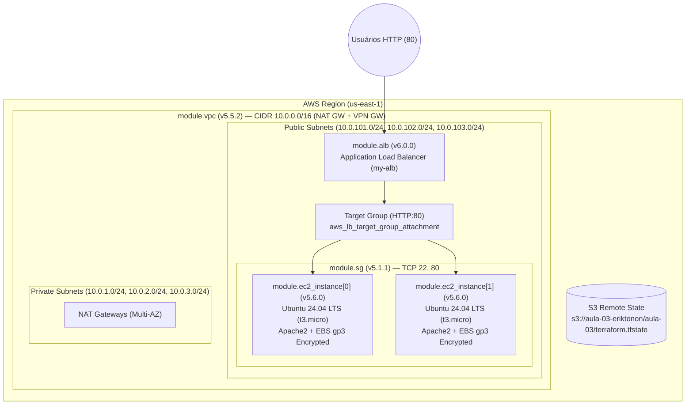

# Aula 03 (Parte 3) — Módulos Oficiais do Terraform Registry, Application Load Balancer (ALB) e GitHub Actions CI/CD


-E95420?logo=ubuntu&logoColor=white)


Repositório prático da **Aula 03 (Parte 3)** da formação **Acelera DevOps & MBA Platform Engineering** (**Erik Tonon**). Enquanto na primeira etapa da Aula 03 construímos módulos locais próprios (`./modules/aws-vpc`), aqui evoluímos para o padrão corporativo utilizando **Módulos Oficiais do Ecossistema `terraform-aws-modules`** com **versionamento imutável via tags Git (`?ref=vX.Y.Z`)**, **Alta Disponibilidade Multi-AZ (3 Zonas de Disponibilidade)**, **Application Load Balancer (ALB)** e validação contínua com **GitHub Actions**.

---

## Arquitetura de Alta Disponibilidade (Multi-AZ + ALB)



---

## Módulos Locais vs. Módulos Oficiais (`terraform-aws-modules`)

| Critério | Módulos Locais (`./modules/...`) | Módulos Oficiais (`terraform-aws-modules`) |
| :--- | :--- | :--- |
| **Manutenção** | Mantida integralmente pela sua equipe interna | Mantida pela comunidade global e especialistas AWS |
| **Controle de Versão** | Acoplado ao commit do próprio repositório | Fixado por release tag semântica (`?ref=v5.5.2`) |
| **Recursos Avançados** | Requer codificação manual de NAT GW, rotas Multi-AZ e sub-redes | Suporte pronto a Multi-AZ, NAT Gateway, VPN Gateway e Tags |
| **Quando Usar** | Regras de negócio muito específicas ou aprendizado dos blocos básicos | Fundações de rede (VPC), ALB, Security Groups e EKS/ECS em produção |

---

## Requisitos e Dependências (`versions.tf`)

| Name | Version |
|------|---------|
| <a name="requirement_terraform"></a> [terraform](#requirement\_terraform) | >= 1.6.0 |
| <a name="requirement_aws"></a> [aws](#requirement\_aws) | >= 5.37.0 |

## Módulos Consumidos (`main.tf`)

| Name | Source | Version |
|------|--------|---------|
| <a name="module_alb"></a> [alb](#module\_alb) | `git::https://github.com/terraform-aws-modules/terraform-aws-alb.git` | `v6.0.0` |
| <a name="module_ec2_instance"></a> [ec2\_instance](#module\_ec2\_instance) | `git::https://github.com/terraform-aws-modules/terraform-aws-ec2-instance.git` | `v5.6.0` |
| <a name="module_sg"></a> [sg](#module\_sg) | `git::https://github.com/terraform-aws-modules/terraform-aws-security-group.git` | `v5.1.1` |
| <a name="module_vpc"></a> [vpc](#module\_vpc) | `git::https://github.com/terraform-aws-modules/terraform-aws-vpc.git` | `v5.5.2` |

## Recursos e Data Sources Adicionais

| Name | Type |
|------|------|
| [aws_lb_target_group_attachment.tg_attachment](https://registry.terraform.io/providers/hashicorp/aws/latest/docs/resources/lb_target_group_attachment) | resource |
| [aws_ami.ubuntu_server](https://registry.terraform.io/providers/hashicorp/aws/latest/docs/data-sources/ami) | data source |

## Inputs (`variables.tf`)

| Name | Description | Type | Default | Required |
|------|-------------|------|---------|:--------:|
| <a name="input_aws_region"></a> [aws\_region](#input\_aws\_region) | Declara a região que está sendo utilizada | `string` | `"us-east-1"` | no |
| <a name="input_azs"></a> [azs](#input\_azs) | The availability zones for subnets | `list(string)` | `["us-east-1a", "us-east-1b", "us-east-1c"]` | no |
| <a name="input_instance_type"></a> [instance\_type](#input\_instance\_type) | The type of EC2 instance to launch | `string` | `"t3.micro"` | no |
| <a name="input_key_name"></a> [key\_name](#input\_key\_name) | The name of the key pair to use for the EC2 instances | `string` | `"deployer_key"` | no |
| <a name="input_private_subnets"></a> [private\_subnets](#input\_private\_subnets) | The private subnets CIDR blocks | `list(string)` | `["10.0.1.0/24", "10.0.2.0/24", "10.0.3.0/24"]` | no |
| <a name="input_public_subnets"></a> [public\_subnets](#input\_public\_subnets) | The public subnets CIDR blocks | `list(string)` | `["10.0.101.0/24", "10.0.102.0/24", "10.0.103.0/24"]` | no |

## Outputs (`outputs.tf`)

| Name | Description |
|------|-------------|
| <a name="output_alb_arn"></a> [alb\_arn](#output\_alb\_arn) | The ARN of the ALB |
| <a name="output_alb_dns_name"></a> [alb\_dns\_name](#output\_alb\_dns\_name) | The DNS name of the ALB |
| <a name="output_ec2_instance_ids"></a> [ec2\_instance\_ids](#output\_ec2\_instance\_ids) | The IDs of the EC2 instances (`module.ec2_instance[*].id`) |
| <a name="output_security_group_id"></a> [security\_group\_id](#output\_security\_group\_id) | The ID of the security group |
| <a name="output_target_group_arns"></a> [target\_group\_arns](#output\_target\_group\_arns) | The ARNs of the target groups |
| <a name="output_vpc_id"></a> [vpc\_id](#output\_vpc\_id) | The ID of the VPC |

---

## Como Executar

### 1. Inicializar Módulos e Backend
```bash
# Para validar localmente sem conectar ao bucket S3 remoto:
terraform init -backend=false

# Para inicializar conectando ao seu bucket S3 de estado remoto:
terraform init
```

### 2. Validar Formatação e Sintaxe
```bash
terraform fmt -check
terraform validate
```

### 3. Planejar, Aplicar e Testar o Load Balancer
```bash
terraform plan -out=tfplan
terraform apply tfplan

# Testar o endpoint DNS do Application Load Balancer:
curl -I "http://$(terraform output -raw alb_dns_name)"
```

### 4. Destruir a Infraestrutura ao Final da Aula
```bash
terraform destroy -auto-approve
```
